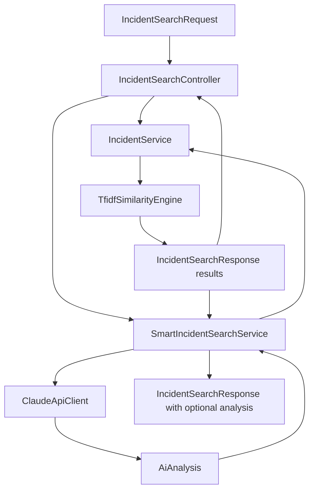

# Backend Code Walkthrough

Backend source root:
`C:\Users\gbala\smart-incident-finder\src\main\java\com\incident\finder`.
The project uses constructor injection and Spring component scanning.

## Application entry point

### `SmartIncidentFinderApplication.java`

- **Package/file:** `com.incident.finder`,
  [`SmartIncidentFinderApplication.java`](../../smart-incident-finder/src/main/java/com/incident/finder/SmartIncidentFinderApplication.java).
- **Responsibility:** starts Spring Boot and registers
  `IncidentSearchProperties` and `ClaudeApiProperties` with
  `@EnableConfigurationProperties`.
- **Input/output:** `main(String[] args)` starts the embedded application;
  there is no application-level return value.
- **Calls/relationships:** component scanning discovers controllers, services,
  engine, and filter. Startup creates the `IncidentService`, which loads and
  validates the dataset through its `@PostConstruct` method.

## Controller package

### `IncidentSearchController.java`

- **Responsibility:** exposes routes under `/api/incidents`.
- **Dependencies:** `IncidentService`, `SmartIncidentSearchService`,
  `IncidentSearchProperties`, and `SearchRequestMetrics`.
- **Methods:** `search(IncidentSearchRequest)` handles `POST /search`;
  `smartSearch(IncidentSearchRequest)` handles `POST /smart-search`.
- **Input:** JSON is bound to the same `IncidentSearchRequest` record and
  validated with `@Valid`. Both methods also enforce
  `maximumDescriptionLength`.
- **Output:** HTTP 200 `IncidentSearchResponse`. The standard method calls
  `IncidentService.searchIncidents`; smart calls
  `SmartIncidentSearchService.search`. Both update request/success counters.
- **Why/next:** keeps HTTP concerns at the boundary, leaving matching and AI
  orchestration to services.

### `GlobalExceptionHandler.java`

- **Responsibility:** maps exceptions to consistent `ApiErrorResponse`
  messages via `@RestControllerAdvice`.
- **Important methods:** `handleInvalidSearch`,
  `handleValidation`, `handleMethodValidation`, `handleUnreadableRequest`,
  `handleUnsupportedMediaType`, `handleUnsupportedMethod`, and
  `handleUnexpected`.
- **Output/status:** malformed or invalid requests return 400; oversized
  request exceptions return 413; unsupported content type returns 415;
  unsupported method returns 405; unexpected errors return 500 with a
  generic message.
- **Calls/next:** increments `SearchRequestMetrics` for invalid/unexpected
  failures. It does not handle `ClaudeApiException` directly: the smart
  service catches that exception and returns historic results.

### `RequestSizeLimitFilter.java`

- **Responsibility:** enforces configured request-body byte limit before MVC
  binding. It first checks known `Content-Length` and wraps the input stream
  to detect oversized bodies when length is unknown.
- **Dependencies:** `IncidentSearchProperties`, `SearchRequestMetrics`,
  `ObjectMapper`.
- **Methods/types:** `doFilterInternal`, `writePayloadTooLarge`,
  `LimitedRequestWrapper`, `LimitedServletInputStream`, and nested
  `RequestBodyTooLargeException`.
- **Output:** direct 413 JSON response for a known oversized content length;
  an input-stream exception for a streamed oversize body, later recognized by
  `GlobalExceptionHandler`.
- **Limit:** default 32,768 bytes. It is a byte limit, distinct from the
  description-character limit.

## Service package

### `IncidentService.java`

- **Responsibility:** owns and validates the historical corpus and forms
  standard search responses.
- **Dependencies:** Jackson `ObjectMapper`, Spring `ResourceLoader`,
  `TfidfSimilarityEngine`, and `IncidentSearchProperties`.
- **Startup method:** `loadIncidents()` reads `classpath:incidents.json`,
  parses the list, validates the record count (10–100), positive/unique IDs,
  and nonblank title/description/resolution, then stores an immutable list.
  Any load/parse/validation error fails startup.
- **Methods:** `getAllIncidents()` returns defensive copies;
  `searchIncidents(String)` validates the description, calls
  `findTopMatches`, validates scores, applies the threshold, maps results,
  and chooses the match/no-match message;
  `toSearchResult(IncidentMatch)` rounds scores to one decimal percentage.
- **Calls/next:** standard controller calls it directly; smart service calls
  it before the selected AI provider. The engine is the matching dependency.
- **Important boundary:** historic result DTOs are built only from `Incident`
  and `IncidentMatch`, never from Claude.

### `SmartIncidentSearchService.java`

- **Responsibility:** coordinates historic search with AI analysis.
- **Dependencies:** `IncidentService`, `AiAnalysisProvider`.
- **Method:** `search(String)` obtains the standard response first, passes its
  results and the user description to the selected provider and returns a
  response with `aiAnalysis`. Typed provider failures propagate to centralized
  handling as HTTP 503.
- **Why/next:** keeps provider integration separate from TF-IDF; standard
  search never invokes the AI service.

### `ClaudeApiClient.java`

- **Responsibility:** performs the outbound Anthropic Messages API call and
  maps model text to `AiAnalysis`.
- **Dependencies:** configured `RestClient.Builder`,
  `ClaudeApiProperties`, and Jackson `ObjectMapper`.
- **HTTP construction:** creates a `RestClient` using a
  `SimpleClientHttpRequestFactory` with configured connect/read timeouts.
  `analyze(description, historicalIncidents)` checks configuration, sends
  JSON containing `model`, `max_tokens`, `system`, and `messages`, and sets
  `x-api-key` and `anthropic-version` headers.
- **Parsing:** `parseAnalysis` reads the first text content block, optionally
  strips Markdown JSON fences, deserializes to `AiAnalysis`, and verifies that
  every required field is present/nonblank.
- **Failures:** maps 401/403 to authentication, 429 to rate-limited, 408/504
  to timeout, other HTTP responses to API failure; recognizes socket
  timeouts and malformed response JSON as typed `ClaudeApiException`.
- **Calls/next:** called only from `SmartIncidentSearchService`; it never
  builds historical identifiers or scores.

### `ClaudeApiProperties.java`

- **Responsibility:** binds `claude.api.*` configuration into typed Java
  properties.
- **Fields:** `apiKey`, `url`, `model`, `apiVersion`, `timeout`, `maxTokens`.
- **Defaults:** key/model `xxxxx`, Anthropic messages URL, version
  `2023-06-01`, timeout 30 seconds, max tokens 1200.
- **Method:** `isConfigured()` rejects blank key/model/url and the literal
  `xxxxx` placeholder. This prevents accidental external calls when
  placeholders remain.

### `ClaudeApiException.java`

- **Responsibility:** typed integration failure carrying
  `FailureType` (`NOT_CONFIGURED`, `AUTHENTICATION`, `RATE_LIMITED`,
  `TIMEOUT`, `INVALID_RESPONSE`, or `API_FAILURE`).
- **Use:** raised by `ClaudeApiClient`, then caught by
  `SmartIncidentSearchService`. It is not sent verbatim to API consumers.

### `IncidentSearchProperties.java`

- **Responsibility:** binds and validates `incident.search.*`.
- **Defaults/constraints:** minimum score 10.0 (0–100), description length
  5000 (1–5000), body size 32768 bytes (1024–1048576).
- **Use:** controller, service, and filter share the same configured values.

### `InvalidIncidentSearchException.java`

- **Responsibility:** domain exception for a blank or over-length
  description. `IncidentService` and controller length checks raise it;
  `GlobalExceptionHandler.handleInvalidSearch` returns HTTP 400.

### `SearchRequestMetrics.java`

- **Responsibility:** atomic process-local counters: total requests,
  successful searches, no-match searches, invalid requests, and unexpected
  errors.
- **Methods:** `recordValidRequest`, `recordSuccessfulSearch`,
  `recordInvalidRequest`, `recordUnexpectedError`, and `snapshot`.
- **Important limitation:** no REST/Actuator endpoint exposes `snapshot`;
  counters reset when the process restarts. Claude failures that fall back
  successfully count as successful searches.

## Engine package

### `TfidfSimilarityEngine.java`

- **Responsibility:** pure in-memory tokenization, TF-IDF vector creation,
  cosine scoring, sorting, tie-breaking, and top-three limiting.
- **Input/output:** `findTopMatches(String, List<Incident>)` returns
  `List<IncidentMatch>` sorted by descending score and then ascending
  incident ID.
- **Calls/next:** invoked by `IncidentService`; it does not know about HTTP,
  thresholds, response messages, or Claude.

## Model package

| Class/file | Responsibility and relationships |
|---|---|
| `Incident.java` | Mutable Jackson-friendly dataset bean: `id`, `title`, `description`, `resolution`. Loaded by `IncidentService`; document text uses title and description. |
| `IncidentMatch.java` | Internal record pairing an `Incident` with raw cosine similarity; produced by the engine and consumed by `IncidentService`. |
| `IncidentSearchRequest.java` | Request record with `description` and Jakarta `@NotBlank`. Bound by both controller routes. |
| `IncidentSearchResult.java` | Public historic result record: `incidentId`, `title`, `similarityPercentage`, `resolution`. Created by `IncidentService`. |
| `IncidentSearchResponse.java` | Public response record with message, immutable results, and optional `aiAnalysis`; null analysis is omitted from JSON. |
| `AiAnalysis.java` | Claude-generated analysis record with root causes, explanation, troubleshooting, prevention, and additional recommendations. Lists are defensively copied. |
| `ApiErrorResponse.java` | Consistent one-field `{ "message": "..." }` error DTO. Used by exception advice and request-size filter. |

## Controller → service → engine → Claude

Standard requests stop at the controller's direct `IncidentService` result.
Smart requests use the same search result and then append optional analysis.
The error advice and request filter surround both routes.
