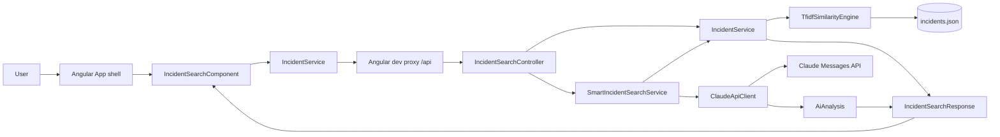

# Project Architecture

## Project layout

The checked-out workspace contains two sibling projects rather than a single
monorepo:

```text
C:\Users\gbala\
├── smart-incident-finder\                 Spring Boot API
│   ├── src\main\java\com\incident\finder\
│   ├── src\main\resources\
│   ├── src\test\java\com\incident\finder\
│   ├── pom.xml
│   └── mvnw.cmd
└── smart-incident-finder-angular\
    ├── frontend\                           Angular 22 application
    │   ├── src\app\
    │   ├── angular.json
    │   └── package.json
    └── docs\                               These documents
```

Backend source links in these documents are relative to `docs/`, for example
[`IncidentSearchController.java`](../../smart-incident-finder/src/main/java/com/incident/finder/controller/IncidentSearchController.java).
Frontend source links point to
[`frontend/src`](../frontend/src).

## Responsibilities and boundaries

### Angular frontend

The standalone Angular application renders one incident-search page. The
`IncidentSearchComponent` owns user interaction and view state: description,
validation, current search mode, loading, errors, historical matches, and
optional AI analysis. `IncidentService` is the HTTP boundary; it posts the
description to the standard or smart endpoint and validates the response
shape. TypeScript interfaces in `models/incident.model.ts` describe that
contract.

The frontend does not contain incident data, similarity algorithms, Claude
credentials, or AI prompt construction. During development, `/api` is proxied
to `http://localhost:8080` by [`proxy.conf.json`](../frontend/proxy.conf.json).
The frontend has no Bootstrap, PrimeNG, NgRx, or other UI/state library; the
current screen uses component and global CSS.

### Spring Boot backend

The backend owns input validation, the historical `incidents.json` dataset,
TF-IDF/cosine calculations, thresholding, and final incident result DTOs. The
standard endpoint returns only the historic search response. The smart
endpoint first gets the same authoritative TF-IDF response, then asks the
selected `AiAnalysisProvider` for additional analysis. AI output cannot replace
incident IDs, titles, scores, or resolutions because those fields are copied
from the Java search response.

The backend is stateless with respect to user searches. It loads and validates
the 95-record incident dataset once during startup; counters in
`SearchRequestMetrics` are process-local atomics. There is no database,
authentication layer, persistence of searches, or metrics HTTP endpoint in
the inspected code.

## Package structure

| Backend package | Purpose |
|---|---|
| `com.incident.finder` | `SmartIncidentFinderApplication`, Spring Boot entry point and configuration-properties registration. |
| `com.incident.finder.controller` | REST routes, centralized exception responses, and the request-body size filter. |
| `com.incident.finder.service` | Dataset/search orchestration, typed configuration, AI provider integrations, custom validation exception, and in-memory counters. |
| `com.incident.finder.engine` | Pure TF-IDF and cosine-similarity ranking logic in `TfidfSimilarityEngine`. |
| `com.incident.finder.model` | Dataset models, API request/response/result DTOs, AI analysis DTO, and error DTO. |

The Angular application is organized as:

| Angular location | Purpose |
|---|---|
| `frontend/src/app/app.ts`, `app.html`, `app.config.ts`, `app.routes.ts` | Standalone application shell, bootstrap providers, and root route. |
| `frontend/src/app/components/incident-search/` | Search screen, template, styles, and component tests. |
| `frontend/src/app/services/incident.service.ts` | HttpClient requests, timeout, response-shape validation, and error translation. |
| `frontend/src/app/models/incident.model.ts` | Request, response, historical-result, and AI-analysis interfaces. |
| `frontend/src/environments/environment.ts` | Same-origin API base path (`/api`). |

## Component relationships



The diagram shows the two controller branches: `/search` calls
`IncidentService` directly; `/smart-search` calls
`SmartIncidentSearchService`, which reuses `IncidentService` before making the
optional Claude call.

## Request and response ownership

`IncidentSearchRequest` carries the user description. `IncidentService`
returns an `IncidentSearchResponse` containing `message` and a list of
`IncidentSearchResult`. The two-argument response constructor is used by
standard search; the optional `aiAnalysis` component is null and omitted from
JSON using `@JsonInclude(NON_NULL)`. Smart search can return the same response
plus an `AiAnalysis` object.

The distinction is important: historic result fields are Java-owned,
verified dataset content; `AiAnalysis` is model-generated guidance and is not
a verified resolution.

## Technology choices reflected in the code

- **Java 21 and Spring Boot 3.5.3:** application runtime, dependency injection,
  configuration, REST controllers, validation, and test integration.
- **Spring Web `RestClient`:** synchronous typed HTTP calls to Claude without
  adding a separate HTTP client dependency.
- **Jackson:** reads the local dataset, serializes prompt context, parses
  Claude's response, and serializes REST DTOs.
- **Jakarta Validation:** rejects blank descriptions at the request DTO
  boundary; explicit service/controller checks enforce the length limit.
- **Angular 22 standalone APIs:** small routed frontend without NgModule
  boilerplate.
- **Angular HttpClient and RxJS:** HTTP calls, request timeout, error mapping,
  and reliable loading cleanup with `finalize`.
- **JUnit 5, Mockito, Spring MockMvc, and `MockRestServiceServer`:** unit,
  controller, and application-context tests; Claude requests are mocked.
- **JSON flat file:** keeps the demo/search corpus easy to inspect and ship;
  it is loaded once into memory instead of requiring a database.

## Architecture trade-offs

The search engine recalculates document terms, IDF values, and vectors for
each search. This is straightforward and appropriate for the current corpus
of 95 records, but it does not cache an index for a much larger corpus. Smart
search is synchronous: the frontend waits for the Java search and Claude
request in one HTTP response. The backend timeouts bound the Claude
connection/read wait; the Angular request timeout is shorter (15 seconds),
which can end the browser request before the backend's 30-second Claude
timeout.

There is no Docker configuration in either project root. CORS is not
configured in the backend; local development avoids cross-origin requests by
using the Angular `/api` proxy. A separately hosted production frontend would
need deployment routing or explicit backend CORS configuration.
